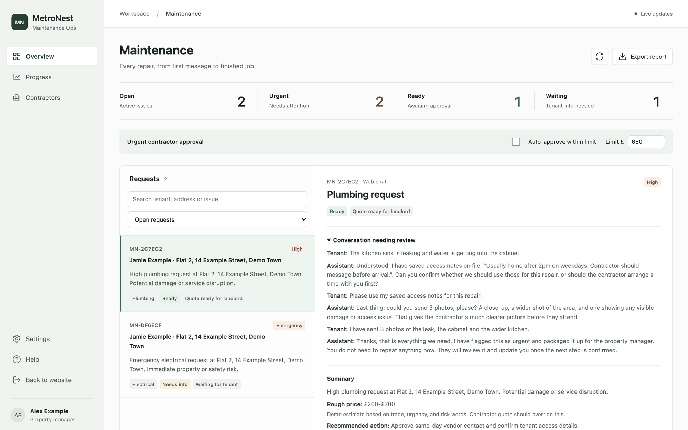
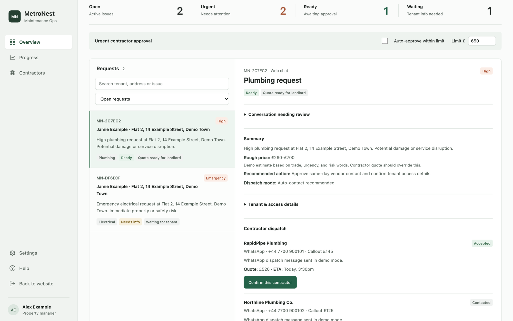

# MetroNest: property maintenance triage agent

[](https://github.com/SammyJ3000/metronest-triage-agent/actions/workflows/ci.yml)

I built MetroNest as a demo of an AI agent that takes a tenant's repair message and turns it into a work order a property manager can act on. It is a portfolio piece, not a live client product. MetroNest is a made up company. Every tenant, landlord, address, contractor and phone number in this repo is fictional.



## What it is

A tenant reports a problem in plain words, often messy ones. The agent asks for the details that are missing, one question at a time. It then sorts the job by trade and urgency, suggests contractors and drafts the messages. A person on the landlord side reviews it and decides what happens next. Nothing is booked, sent or paid for without that person.

There are three parts:

1. A tenant chat bot on Telegram.
2. A landlord dashboard in the browser.
3. A small Node server that holds the work orders and runs the triage.

Contractor outreach is simulated. No real contractor is ever contacted.

## Screenshots

The same request further down: the triage summary, the rough price and the first contractor quote waiting for the landlord to confirm.



## How it works

```
Tenant message
(Telegram bot, or POST /api/chat)
        |
        v
LLM intake  (executions/llm-intake.mjs)
  OpenAI Responses API, strict JSON schema, store: false
  reads the conversation, fills fields, writes the next question
  no tools: it cannot book, contact or approve anything
        |
        |  on error, timeout or bad output: rules based intake instead
        v
Deterministic triage  (executions/triage-engine.mjs)
  checks required fields, counts real photo attachments,
  sets category, urgency, risk, price range, contractors, drafts
        |
        v
Landlord dashboard  (public/dashboard.html, served by server.mjs)
  inbox, work order, contractor quotes, status
        |
        v
A human approves contractor contact and quotes
```

The intake collects six things: what is wrong, the tenant's name, the address, whether there is active danger, access for this repair, and three photos.

## Design decisions

**Strict structured output.** The model must reply in a fixed JSON schema with no extra fields. The app then checks every field again before it uses any of it. If the output does not fit, it is thrown away.

**No tools, so the model cannot act.** The prompt states the model has no tools to book visits, contact contractors or approve quotes, and the code gives it none. It can only suggest field updates and a reply. Contractor contact and quote approval live in the server and the dashboard, behind a person.

**The app decides, not the model.** Photo counts come from real Telegram attachments, not from a tenant saying "I sent them". Access permission only changes if the model quotes the tenant's latest message as evidence, and a bare "yes" only counts when the tenant was asked about access. Whether a report is complete is worked out from the required fields, not from what the model claims.

**Rules fallback on failure or timeout.** If there is no API key, the provider fails, the call takes longer than 15 seconds or the output is invalid, the rules based intake takes over. The demo runs fully without any key. Set `METRONEST_LLM_ENABLED=false` to force rules only.

**`store: false`.** Requests ask OpenAI not to store the conversation. Only the current fields and the last 24 messages are sent. Photos are counted, never sent to the model. Errors log a status code only, not the provider's reply.

**Tests.** The triage rules, the server API and the LLM adapter each have a test file. The LLM tests use a mocked API, so they need no key and spend no credits.

## What broke and how I fixed it

These come from the project's own run logs.

**The bot asked the same question again and again.** A tenant sent "i have an issue", then "the pwoer is out", then "no". The parser took the vague first message as the description, missed the typo, and needed a risk keyword even for a "no". I kept vague openers out of the description, mapped common misspellings of power and electricity for sorting while keeping the tenant's own words, and read yes or no against the question actually asked. If an answer still makes no sense after one clarifying question, the chat is flagged for the manager with the transcript.

**A new problem was added to an old report.** A saved Telegram chat was still waiting for photos on an earlier power cut. A new "I have an issue" message carried on that old report and asked the saved access question first. Now phrases like "I have an issue" or "start again" open a fresh report. Old work orders and the tenant profile stay, but risk, access and photos do not carry over. The issue description is now always the first thing asked.

**Two contractors could be confirmed at once.** Server changes now run one at a time, and the store file is replaced in one step so a read never sees half a file. The server test fires two confirmations together and expects one to succeed and one to be refused.

**Smaller fixes.** Resolved jobs were still counted as active. The default port was already taken by another server, so the server now tries the next free port and prints the one it used.

## Setup

You need Node 18 or newer. The server, bot and tests use only built in Node modules.

```bash
git clone <this repo>
cd metronest-triage-agent
cp .env.example .env     # optional, see below
npm start
```

Open the address the server prints, usually http://127.0.0.1:4173. The landlord dashboard is at `/dashboard` and a small product page is at `/`.

The work order store is written to `data/maintenance-store.json` on first run.

### Optional: conversational intake

Put an OpenAI key in `.env` as `OPENAI_API_KEY`. `OPENAI_MODEL` defaults to `gpt-4.1-mini`. Restart the server and the bot after changing `.env`. `/api/health` shows whether the key is set and how the last call went.

### Optional: Telegram tenant bot

1. Create a bot with BotFather on Telegram and copy its token.
2. Set `TELEGRAM_BOT_TOKEN` in `.env`.
3. Run the server with `npm start`, then the bot in a second terminal:

```bash
npm run telegram
```

The bot uses long polling, so it works on your own machine with no public URL. A chat that is not listed under a tenant's `telegramChatIds` in `resources/tenant-directory.json` is treated as the default demo tenant. The "Open tenant bot" button in `public/dashboard.html` points to a placeholder link; change it to your bot's username.

### Without Telegram

You can send tenant messages straight to the API:

```bash
curl -X POST http://127.0.0.1:4173/api/chat \
  -H "content-type: application/json" \
  -d '{"sessionId":"demo","message":"The kitchen sink is leaking into the cabinet"}'
```

Photos only count when they arrive as Telegram attachments, so a report sent this way stops at the photo step. That is on purpose.

### Optional: dashboard screenshot

`executions/screenshot-dashboard.mjs` seeds a sample request and saves a screenshot to `tmp/`. It needs Playwright:

```bash
npm install
npx playwright install chromium
DASHBOARD_URL=http://127.0.0.1:4173 node executions/screenshot-dashboard.mjs
```

## Tests

```bash
npm test
```

This runs `triage-engine.test.mjs`, `server.test.mjs` and `llm-intake.test.mjs`. The tests need no install. The server test starts its own copy of the server on a free port with a temporary store, so it does not touch your demo data. No test makes a network call to OpenAI or Telegram, and none needs a key. The "LLM intake fallback" lines in the output are expected; they come from the tests that check failure handling.

```bash
npm install
npm run lint
```

`npm run lint` checks the code with ESLint, which is a dev dependency. GitHub Actions runs the lint and the tests on every push and pull request.

## Project layout

```
server.mjs                     web server and JSON API
public/                        landlord dashboard and product page
executions/triage-engine.mjs   rules based intake and triage
executions/llm-intake.mjs      OpenAI adapter with schema and checks
executions/telegram-polling-bot.mjs
executions/store.mjs           the JSON store, shared by the server and the bot
executions/env.mjs             loads .env
executions/*.test.mjs          tests
resources/                     fictional tenants and demo scenarios
directives/                    the workflow rules the agent follows
planning/                      scope and dashboard notes
```

## Stack

Node.js with no runtime dependencies, plain HTML, CSS and JavaScript for the dashboard, the OpenAI Responses API for intake, the Telegram Bot API for tenant chat, and a JSON file for storage. Playwright is only used for screenshots, and ESLint for linting.

## About me

I'm Sam Jordan. I design and build apps and AI tools with Claude Code. More of my work: https://sam-jordan-cv.vercel.app
